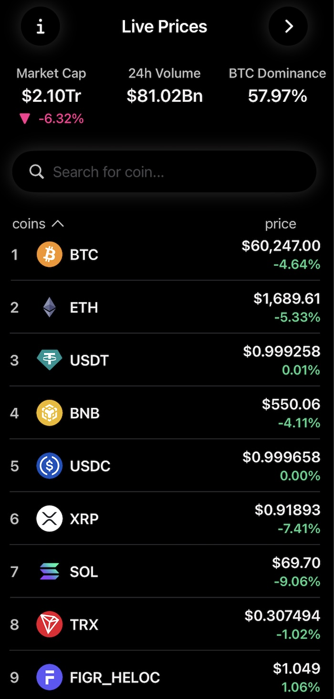
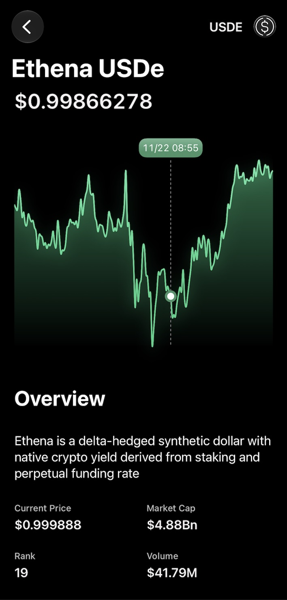
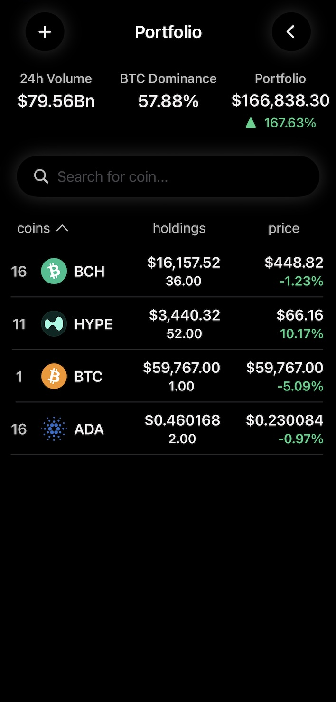
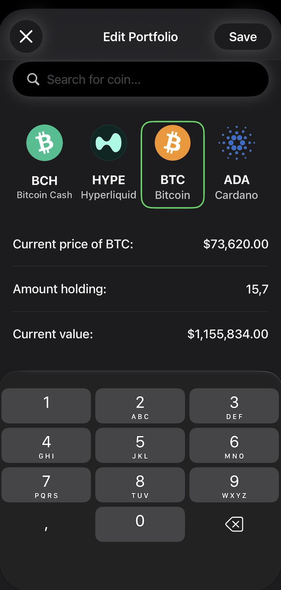
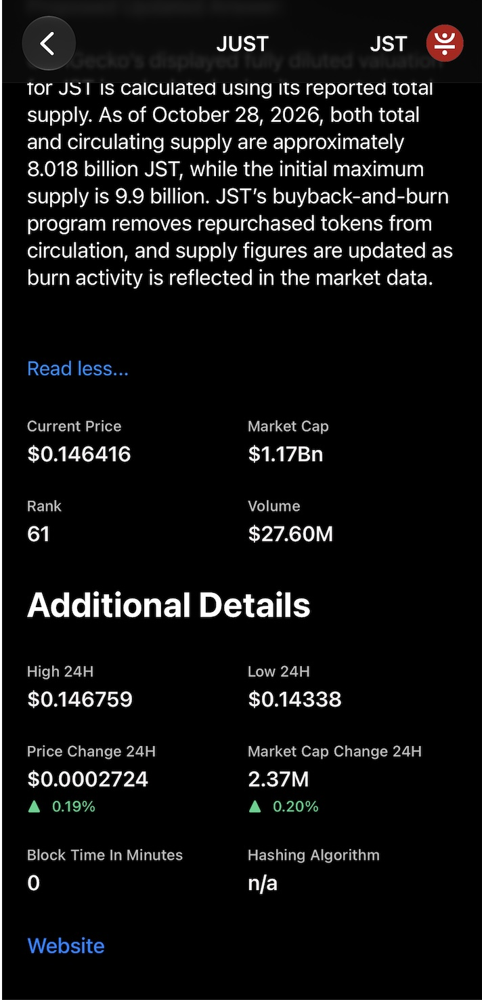

<p align="center">
  
</p>

<h1 align="center">Coinova</h1>

<p align="center">
  A cryptocurrency tracker built with SwiftUI — live market data, detailed coin insights,<br/>
  interactive price charts, and a personal portfolio you can track locally.
</p>

<p align="center">
  
  
  
  
  
</p>

---

## 📱 Screenshots

| Live Prices | Coin Detail | Portfolio |
|:---:|:---:|:---:|
|  |  |  |

| Edit Portfolio | Coin Details |
|:---:|:---:|
|  |  |

---

## ✨ Features

- **Live prices** — browse the top 250 coins with rank, price, and 24h percentage change, fetched from the CoinGecko API
- **Market overview** — a stats bar showing total market cap, 24h volume, BTC dominance, and your portfolio value
- **Coin detail** — price chart with selectable data point, overview, market cap, volume, rank, 24h high/low, price change, and additional metadata
- **Portfolio tracking** — add, edit, and remove holdings for any coin; values are recalculated instantly
- **Local persistence** — holdings are stored in a local SQLite database and survive app launches
- **Search & sorting** — search across live or held coins and sort by rank, price, or holdings
- **Appearance modes** — light, dark, and system themes
- **Offline-aware networking** — waits for connectivity before fetching when the network is unavailable

---

## 🏗 Architecture

Coinova follows **MVVM** with a lightweight service layer and dependency injection:

- **Models** — `Codable` structs that map CoinGecko responses and GRDB records (`Coin`, `CoinDetail`, `MarketData`, `StatisticModel`)
- **ViewModels** — `@Observable` classes that expose state to views and coordinate services (`HomeViewModel`, `CoinDetailViewModel`, `PortfolioViewModel`, `CoinHistoryPriceChartViewModel`)
- **Views** — SwiftUI views composed from reusable components (stat cards, coin rows, charts, navigation buttons)
- **Services** — networking, caching, image loading, search, and database access, resolved through `Factory`
- **Database** — `GRDBDatabase` handles migrations, saves, fetches, and reactive `ValueObservation` streams

---

## 📁 Project Structure

```
CryptoApp/
├── Core/
│   ├── Components/        # Reusable UI (stat cards, coin image, search bar, buttons)
│   ├── Config/            # API configuration
│   ├── Detail/            # Coin detail screen, chart, and view models
│   ├── Home/              # Home screen, view models, and sheets
│   │   └── Sheets/
│   │       ├── Portfolio/ # Portfolio editing UI and view model
│   │       └── Settings/  # Settings screen
│   ├── Modifiers/         # Custom view modifiers
│   ├── Navigation/        # Router and route definitions
│   └── Style/             # Button styles
├── Database/              # GRDB setup and queries
├── Extensions/            # Swift and SwiftUI extensions
├── Models/                # API and database models
├── Networking/            # Endpoints, network monitor, error handling
├── Services/              # Coin, market data, search, cache, image services
├── Theme/                 # Colors and appearance
└── Resources/             # Assets and app icon
```

---

## 🚀 Getting Started

### Requirements

- iOS 17.0+
- Xcode 15+
- Swift 5.9+

### Installation

```bash
git clone https://github.com/pripandrei/Coinova.git
cd Coinova
open CryptoApp.xcodeproj
```

Swift Package Manager dependencies resolve automatically when the project opens in Xcode. Select a simulator or device and press **⌘R** to run.

### CoinGecko API key

The app reads an optional `COINGECKO_API_KEY` from `Info.plist`. If it is not set, a built-in demo key is used. To use your own key, add it to `Config.xcconfig` (excluded from version control) or to `Info.plist`.

---

## 📦 Dependencies

| Package | Purpose | Link |
|---|---|---|
| GRDB | Local SQLite database for portfolio persistence | [groue/GRDB.swift](https://github.com/groue/GRDB.swift) |
| Kingfisher | Async image loading and caching | [onevcat/Kingfisher](https://github.com/onevcat/Kingfisher) |
| Factory | Dependency injection | [hmlongco/Factory](https://github.com/hmlongco/Factory) |
| LoaderUI | Loading indicators | [ninjaprox/LoaderUI](https://github.com/ninjaprox/LoaderUI) |

---

## 🌐 API Reference

Coinova uses the public [CoinGecko API](https://www.coingecko.com/en/api):

| Endpoint | Purpose |
|---|---|
| `/coins/markets` | Coin list with rank, price, market cap, and 24h change |
| `/coins/{id}` | Coin details — description, links, and metadata |
| `/coins/{id}/market_chart` | Historical prices for the detail chart |
| `/global` | Global market stats — market cap, volume, and dominance |

---

## 📄 License

Released under the **MIT License** — see [LICENSE](LICENSE).

---
